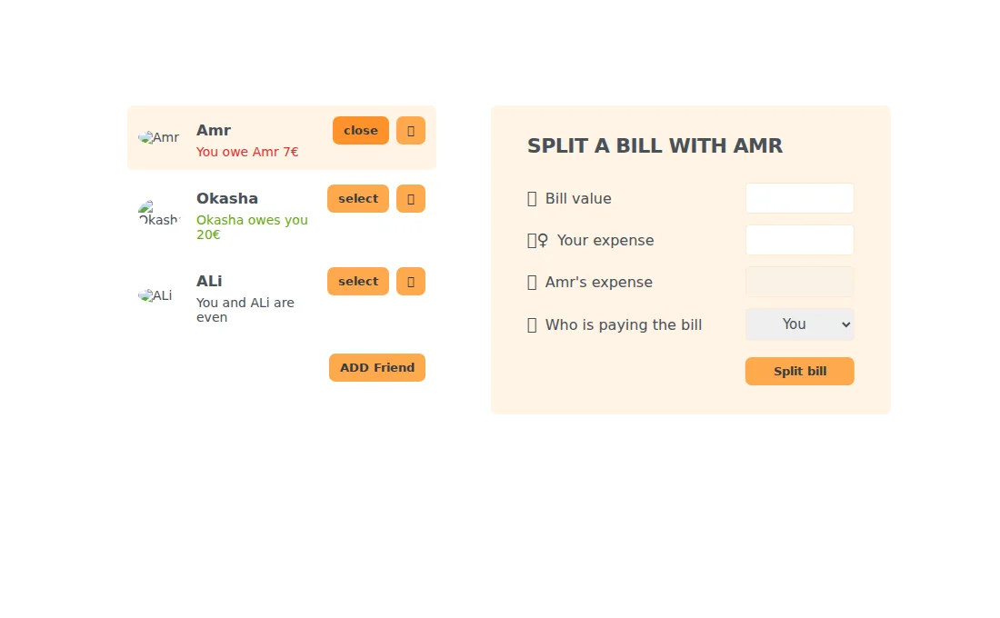

# Split Calculator

A React practice app for splitting a bill with a friend. Select or add a friend, enter the total and your share, and record who paid to update the displayed balance.

[Open the live demo](https://splitcalc.netlify.app/)



## Run locally

```bash
npm ci
npm start
```

Open `http://localhost:3000`. Use `npm run build` for the static bundle.

**Stack:** React, JavaScript, CSS, Framer Motion, and SweetAlert2. The [main component](src/App.js) contains the friend-list, form, and balance calculations.
